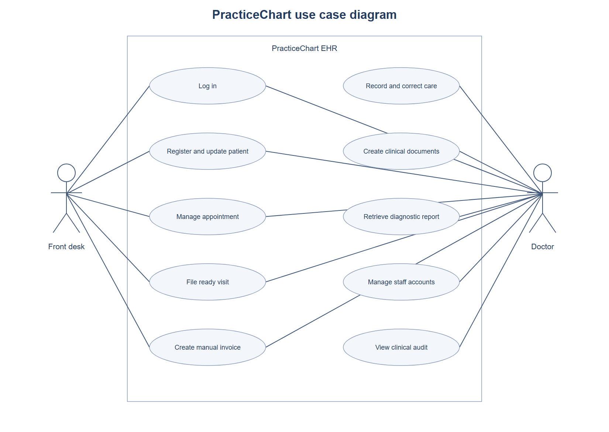
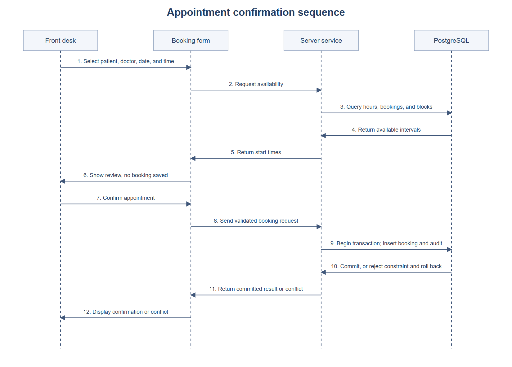
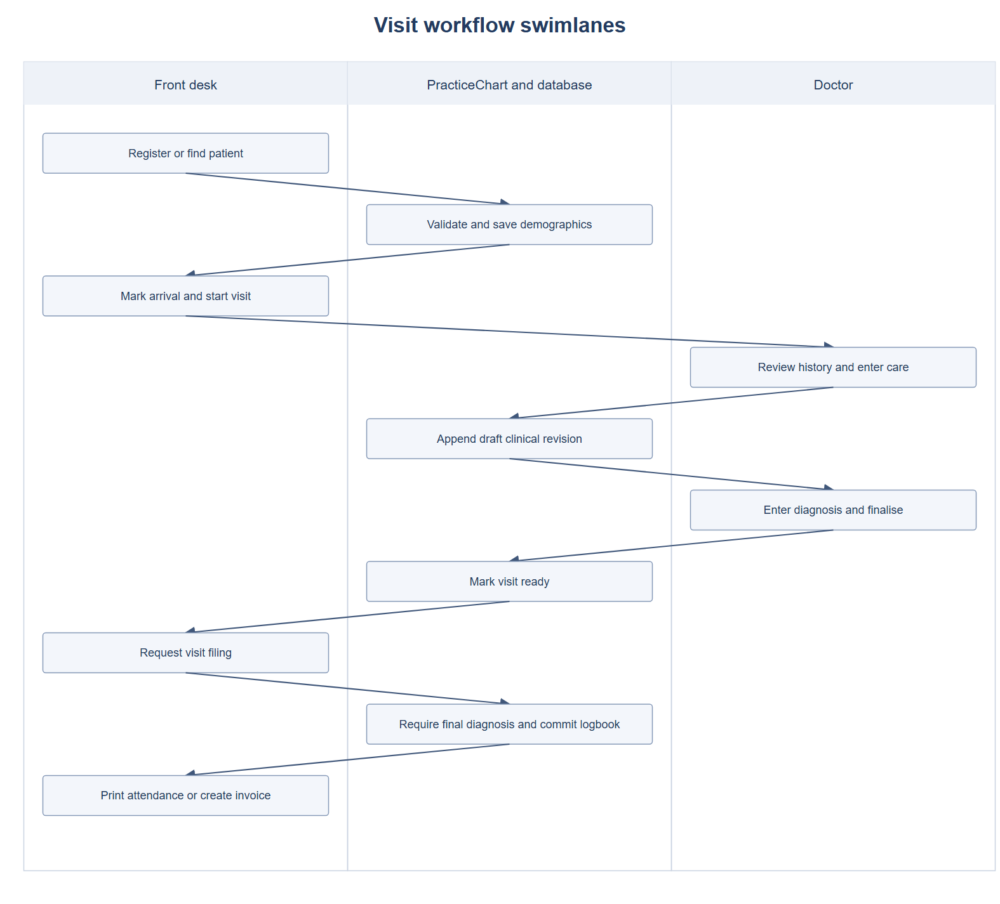
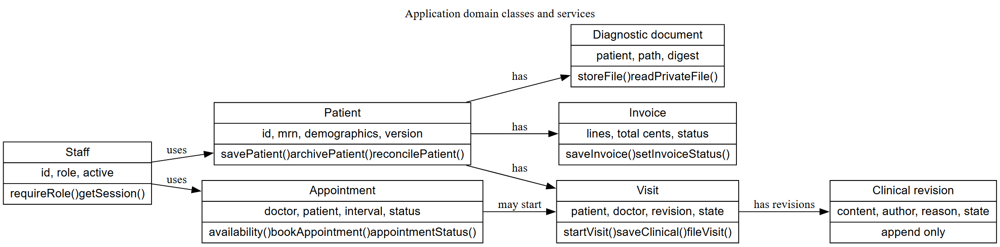
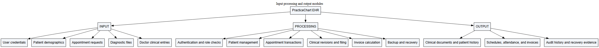
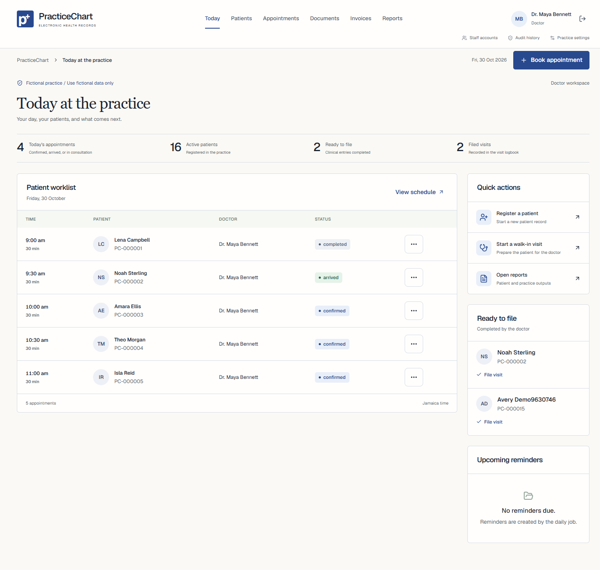
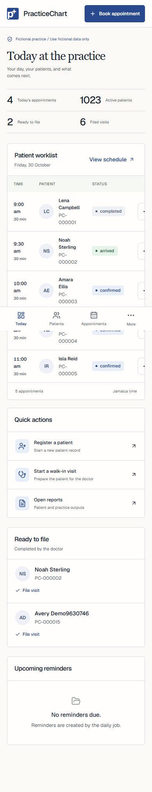

# PracticeChart software development and implementation report

## Introduction

PracticeChart is a working EHR course application for a private medical practice. It replaces the case study's paper record steps with role-controlled digital workflows. The intended users are doctors and front desk staff. Development, tests, screenshots, and the public demo use fictional records only. No live practice rollout, clinical approval, legal compliance, completed training, or human acceptance is claimed.

The project brief defines the EHR business scope. The assignment guide defines this report and the two manuals. The syllabus requires implementation, testing, metrics, maintenance, configuration management, and team participation. The old application and earlier change record were deleted. Their code and test results were not reused as EHR evidence.

## Scope and objectives

Support patient registration and retrieval, administrative updates, safe appointment scheduling, consultation records, diagnostic files, prescriptions, certificates, visit filing, manual invoices, and reports. Preserve earlier clinical entries and audit history. Provide an encrypted full backup and a measured restore test. Keep the local presentation data across restarts.

There is no patient portal, payment processor, AI clinical advice, biometric authentication, external medical practice connection, Ministry of Health connection, pharmacy integration, or laboratory integration. Email delivery is deferred. In-app reminders are included. Hardware purchasing and staff training are not represented as completed work.

## Requirements and constraints

REQUIREMENTS.md records source references, conflicts, and decisions. The scanned requirements include unique usernames, role limits, audit history, daily backup, a three second login target, a two second patient retrieval target, 50 concurrent users, and a 99 percent operational availability target. The short tests measure the first three performance conditions locally. They cannot prove long-term availability or legal compliance.

Development used a Windows computer, Node.js, Docker Desktop, PostgreSQL 18, and Chromium. The local benchmark environment was AMD Ryzen 5 7535HS with Radeon Graphics, 12 logical CPUs, 31.2 GiB RAM, Node v26.12.1, and Next.js 16.4.3. The cloud demo uses the existing Vercel project, separate Neon EHR databases, and new private Blob paths. Free service limits remain a constraint.

Inputs include credentials, patient demographics, booking intervals, doctor-entered clinical data, diagnostic files, and invoice lines. Outputs include confirmation and error messages, schedules, patient history, prescriptions, medical certificates, visit summaries, attendance slips, invoices, audit history, and recovery evidence. A patient report and full EHR backup are different outputs.

## Design and implementation process

The brief, assignment guide, syllabus, schedule, supporting lesson documents, and all 53 embedded images were reviewed. Requirements were separated from old-system interviews, lesson examples, draft algorithms, and unsupported statements. Source conflicts were recorded before implementation. The user selected manual invoices and in-app reminders.

The implementation used small server services, validation schemas, explicit role checks, SQL migrations, database constraints, and a shared interface. The initial green sidebar design was rejected as too close to the earlier application's appearance. It was replaced with ink-blue accents, warm light surfaces, top navigation, a patient worklist, and segmented record controls. No deleted application source or saved design reference was used.

Coding and automated checks were performed with AI assistance in this workspace. These files do not assign module authorship to group members. The group must review the implementation, record each member's actual code contribution, and complete the human course tasks in GROUP_START_GUIDE.md.

## Architectural design

The browser uses Next.js pages and authenticated route handlers. Zod validates inputs. Drizzle services use PostgreSQL transactions. A restricted runtime database role cannot alter the schema or overwrite protected history. Clinical and audit changes commit together. Private files are streamed only after role checks. Workflow state contains IDs and result counts, not clinical bodies.

The class diagram represents domain models and service operations. The implementation uses TypeScript types, functions, and Drizzle table models. It does not pretend that every domain model is implemented as an object-oriented class.

## Procedural design

MODULES.md contains source-linked processing narratives and graph instructions for 26 functions. CONTROL_FLOW.md contains the three complexity calculations, planar face boundaries, and independent syntactic candidates. TEST_PLAN.md maps feasible state and input cases to executable tests. Database constraints are tested through PostgreSQL, rather than assigned invented JavaScript branch counts.

## Interface design

The Today page leads with a patient worklist. The patient record separates demographics, visits, doctor-only clinical entries, and private documents. Shared forms show labels, required fields, errors, busy states, and confirmation. Booking uses a review step before commit. Final clinical corrections require a reason. Reduced-motion preferences remove motion. The phone view uses a compact bottom navigation.

## Testing and actual results

Vitest recorded 74 passing tests and 0 failed tests. Playwright recorded 8 passing browser tests and 0 unexpected failures. The measured Vitest library coverage was 91.42% of statements and 81.08% of branches. This is not a claim of full path coverage.

Unit and database tests cover valid and invalid partitions, boundaries, session and account states, simultaneous bookings, stale changes, clinical corrections, document rules, and invoices. Complete browser tests cover both roles. Direct clinical and file routes are denied to the front desk. Axe recorded zero violations on the nine checked desktop pages and the checked emulated phone page. Automated scans do not replace a full accessibility review or a real phone test.

### Performance

The fixture contained 1016 fictional patients and 5 clinical revisions. Each load ran for 30 seconds. At loads above one, each background session requested a patient search and detail, then waited one second. One browser session measured complete record display. The first display is reported separately from later displays. The first display is not a claim of a cold server start.

| Active sessions | Seconds | Browser login ms | First record ms | Warm display p95 ms | API requests | Request errors |
| --- | --- | --- | --- | --- | --- | --- |
| 1 | 30 | 258.99 | 148.87 | 164.21 | 0 | 0 |
| 10 | 30 | 255.45 | 138.26 | 190.66 | 522 | 0 |
| 50 | 30 | 625.71 | 144.72 | 271.42 | 2818 | 0 |

All measured browser logins were below three seconds. All measured warm record displays were below two seconds. Only one browser login was measured at each load. The server was a local production build. PostgreSQL ran in Docker on the same host. These results do not prove equivalent cloud performance or 99 percent availability.

### Recovery

The full encrypted EHR recovery bundle restored into an isolated local PostgreSQL 18 database. The actual result was passed. The test compared 16 tables and 2 uploaded documents. The measured restore phase took 1.029 seconds. It checked file hashes and bytes, MRN sequencing, immutable histories, and overlap rejection. RECOVERY.md explains key custody, daily scheduling, retention, and limits.

### Defects found and corrected

| Observed defect | Cause and correction | Retest |
| --- | --- | --- |
| Local login rejected a valid page origin | Internal host differed from the request host. Check the actual request host. | Both role logins pass |
| Available times changed after a newer date was selected | A late response replaced newer state. Ignore superseded responses. | Booking and rescheduling pass |
| Booking confirmation rejected a returned time | PostgreSQL timestamp output needed ISO normalisation. Normalise before submission. | Confirmation workflow passes |
| Saved textarea label lookup was inconsistent | Default text entered the nested label text. Add explicit accessible names. | Clinical correction workflow passes |
| A container did not trust the cloud certificate chain | Its trust store differed from Node. Supply the trusted Node CA set and retain hostname verification. | Cloud backup and restore evidence |

## Implementation method and maintenance

Use a phased conversion with a parallel reference process if the practice later approves real deployment. Begin with registration and scheduling. Add clinical recording and controlled document outputs after training. This reduces the amount of change at one time. It also requires extra checks and a clear authoritative record. This is a proposed method, not a completed pilot.

Use versioned migrations, reviewed branches, a lockfile, regression tests, and a release record. Keep recovery keys and backups private. Review failed daily jobs. Check restore ability after schema or storage changes. Train staff before any real use. Keep a support contact and issue register.

## Human testing and remaining work

No completed user acceptance, staff training, live pilot, or real-device testing is claimed. Blank forms and a training plan are supplied. Each member must complete and explain a module contribution. Confirm the actual group presentation slot and private submission cover details with the tutor.

## References

University of Technology, Jamaica. (n.d.). Assignment guide [Course handout].

University of Technology, Jamaica. (n.d.). Software implementation and testing syllabus [Course outline].

University of Technology, Jamaica. (2026). Software implementation schedule 2026 to 2027 semester 1 [Course schedule].

Group 2. (2026). Software implementation group project semester 1 2026 to 2027 [Private project brief].

PostgreSQL Global Development Group. (2026). PostgreSQL documentation: Range types. https://www.postgresql.org/docs/current/rangetypes.html

Neon. (2026). Migrate data from Postgres with pg_dump and pg_restore. https://neon.com/docs/import/migrate-from-postgres

Vercel. (2026). Private storage. https://vercel.com/docs/vercel-blob/private-storage

## Appendices

See REQUIREMENTS.md, TEST_PLAN.md, CONTROL_FLOW.md, MODULES.md, RECOVERY.md, the diagrams, safe evidence files, programme manual, user manual, source listing, and blank training and acceptance forms. Private interviews and course chats are excluded from the public repository.
