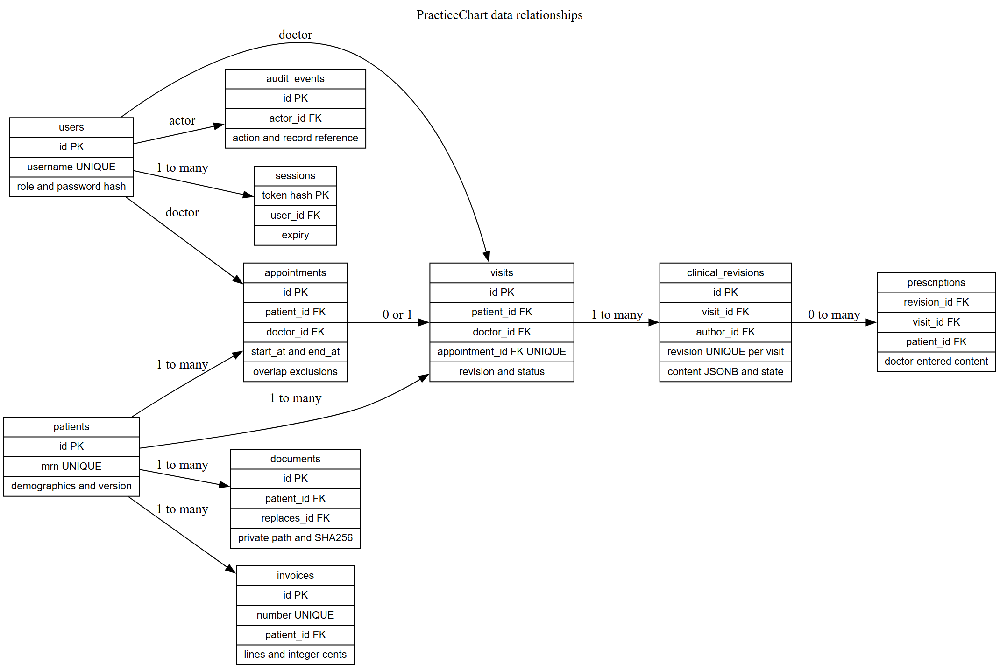
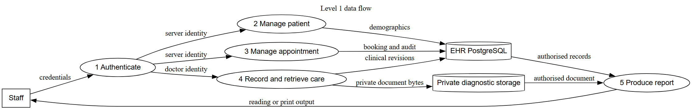

# PracticeChart programme manual

This manual describes the implemented source, database, interfaces, file formats, and operating controls. It is for the group programmer and technical operator. Use the separate user manual for staff tasks.

## Source and architecture

The Next.js App Router hosts the login, workspace, report pages, and route handlers. The workspace is a client interface backed by authenticated server functions. Drizzle models define typed rows. SQL migrations add database-level invariants. The indexed source listing contains all authored application source, migrations, scripts, tests, and project configuration. Third-party packages and generated bundles are excluded.

The important source groups are src/app for routes and pages, src/components for interface modules, src/lib for authentication, validation, storage, and transactional services, and src/workflows for daily work. scripts contains setup, migration, test, performance, course analysis, and recovery tools. The SQL migrations are the authority for constraints and triggers. Schema hashes prevent silent migration changes.

## Database structure

The cloud uses a separate practicechart_ehr database. Preview uses practicechart_preview. The old ticket database is not part of this schema. Local tests use practicechart_test. Restore drills create a new timestamped local database.

| Table | Purpose |
| --- | --- |
| users | Unique staff login, role, password hash, active state, protected demo flag, and version |
| sessions | SHA-256 session token hash, account reference, and expiry |
| login_attempts | Hashed attempt key, count, and expiry |
| patients | Immutable MRN, demographics, provisional link, archive flag, and version |
| doctor_hours | Doctor weekday start and end minutes |
| appointments | Patient, doctor, interval, state, and version |
| schedule_blocks | Unavailable doctor intervals |
| visits | Patient, doctor, optional unique appointment, clinical revision number, and filing state |
| clinical_revisions | Immutable doctor content, revision, state, correction reason, and author |
| prescriptions | Exact doctor-entered medicine fields linked to a final revision |
| documents | Patient association, private path, MIME, size, digest, replacement reference, and author |
| invoices | Unique number, manual line items, integer-cent total, state, reason, and version |
| audit_events | Append-only actor, action, record reference, metadata, and time |
| reminders | Unique appointment and due date pair |
| backup_runs | Backup status, private bundle reference, and time |
| migrations | Applied migration names, hashes, and time |

MRNs and invoice numbers use independent sequences. The number formatting function does not truncate longer sequence values. Patient birth dates cannot exceed the Jamaica calendar day. Appointment intervals are positive and at most four hours. PostgreSQL GiST exclusion constraints reject active overlaps for both doctor and patient. Trigger checks serialize doctor availability changes and reject blocked or outside-hours bookings. A doctor account guard keeps at least one active doctor. Clinical, prescription, and audit histories reject update and delete operations.

The runtime role has no schema creation permission. It cannot update or delete protected history. The migration owner connection is separate from the runtime connection. Password hashes are never returned in staff API responses. Front desk patient queries omit clinical content and document metadata.

## Column dictionary

| Table | Column | PostgreSQL type | Nullable | Default |
| --- | --- | --- | --- | --- |
| appointments | id | uuid | NO | gen_random_uuid() |
| appointments | patient_id | uuid | NO |  |
| appointments | doctor_id | uuid | NO |  |
| appointments | start_at | timestamp with time zone | NO |  |
| appointments | end_at | timestamp with time zone | NO |  |
| appointments | status | text | NO | 'confirmed'::text |
| appointments | version | integer | NO | 1 |
| appointments | created_at | timestamp with time zone | NO | now() |
| audit_events | id | uuid | NO | gen_random_uuid() |
| audit_events | actor_id | uuid | YES |  |
| audit_events | action | text | NO |  |
| audit_events | entity | text | NO |  |
| audit_events | entity_id | text | NO | ''::text |
| audit_events | metadata | jsonb | NO | '{}'::jsonb |
| audit_events | created_at | timestamp with time zone | NO | now() |
| backup_runs | id | uuid | NO | gen_random_uuid() |
| backup_runs | status | text | NO |  |
| backup_runs | pathname | text | YES |  |
| backup_runs | created_at | timestamp with time zone | NO | now() |
| clinical_revisions | id | uuid | NO | gen_random_uuid() |
| clinical_revisions | visit_id | uuid | NO |  |
| clinical_revisions | revision | integer | NO |  |
| clinical_revisions | author_id | uuid | NO |  |
| clinical_revisions | state | text | NO |  |
| clinical_revisions | content | jsonb | NO |  |
| clinical_revisions | reason | text | NO | ''::text |
| clinical_revisions | created_at | timestamp with time zone | NO | now() |
| doctor_hours | doctor_id | uuid | NO |  |
| doctor_hours | weekday | integer | NO |  |
| doctor_hours | start_min | integer | NO |  |
| doctor_hours | end_min | integer | NO |  |
| documents | id | uuid | NO | gen_random_uuid() |
| documents | patient_id | uuid | NO |  |
| documents | title | text | NO |  |
| documents | kind | text | NO |  |
| documents | pathname | text | NO |  |
| documents | mime | text | NO |  |
| documents | size | integer | NO |  |
| documents | sha256 | text | NO |  |
| documents | replaces_id | uuid | YES |  |
| documents | author_id | uuid | NO |  |
| documents | created_at | timestamp with time zone | NO | now() |
| invoices | id | uuid | NO | gen_random_uuid() |
| invoices | number | text | NO | next_record_number('INV-'::text, 'invoice_seq'::regclass) |
| invoices | patient_id | uuid | NO |  |
| invoices | lines | jsonb | NO |  |
| invoices | total_cents | integer | NO |  |
| invoices | status | text | NO | 'draft'::text |
| invoices | version | integer | NO | 1 |
| invoices | reason | text | NO | ''::text |
| invoices | created_at | timestamp with time zone | NO | now() |
| login_attempts | key | text | NO |  |
| login_attempts | count | integer | NO | 1 |
| login_attempts | expires_at | timestamp with time zone | NO |  |
| migrations | name | text | NO |  |
| migrations | sha256 | text | NO |  |
| migrations | applied_at | timestamp with time zone | NO | now() |
| patients | id | uuid | NO | gen_random_uuid() |
| patients | mrn | text | NO | next_record_number('PC-'::text, 'mrn_seq'::regclass) |
| patients | first_name | text | NO |  |
| patients | last_name | text | NO |  |
| patients | dob | date | NO |  |
| patients | phone | text | NO |  |
| patients | address | text | NO |  |
| patients | gender | text | NO | 'Not stated'::text |
| patients | emergency_contact | text | NO | ''::text |
| patients | insurance | text | NO | ''::text |
| patients | provisional_reason | text | NO | ''::text |
| patients | merged_into | uuid | YES |  |
| patients | archived | boolean | NO | false |
| patients | version | integer | NO | 1 |
| patients | created_at | timestamp with time zone | NO | now() |
| prescriptions | id | uuid | NO | gen_random_uuid() |
| prescriptions | visit_id | uuid | NO |  |
| prescriptions | revision_id | uuid | NO |  |
| prescriptions | patient_id | uuid | NO |  |
| prescriptions | content | jsonb | NO |  |
| prescriptions | created_at | timestamp with time zone | NO | now() |
| reminders | id | uuid | NO | gen_random_uuid() |
| reminders | appointment_id | uuid | NO |  |
| reminders | due_date | date | NO |  |
| schedule_blocks | id | uuid | NO | gen_random_uuid() |
| schedule_blocks | doctor_id | uuid | NO |  |
| schedule_blocks | start_at | timestamp with time zone | NO |  |
| schedule_blocks | end_at | timestamp with time zone | NO |  |
| sessions | id | text | NO |  |
| sessions | user_id | uuid | NO |  |
| sessions | expires_at | timestamp with time zone | NO |  |
| sessions | created_at | timestamp with time zone | NO | now() |
| users | id | uuid | NO | gen_random_uuid() |
| users | username | text | NO |  |
| users | name | text | NO |  |
| users | role | text | NO |  |
| users | password_hash | text | NO |  |
| users | active | boolean | NO | true |
| users | protected | boolean | NO | false |
| users | version | integer | NO | 1 |
| users | created_at | timestamp with time zone | NO | now() |
| visits | id | uuid | NO | gen_random_uuid() |
| visits | patient_id | uuid | NO |  |
| visits | doctor_id | uuid | NO |  |
| visits | appointment_id | uuid | YES |  |
| visits | status | text | NO | 'open'::text |
| visits | revision | integer | NO | 0 |
| visits | visit_at | timestamp with time zone | NO | now() |
| visits | filed_at | timestamp with time zone | YES |  |

## Server interfaces

All application data routes require a current session except login and health. The cron route requires its separate secret. Browser mutations must have the same origin as the request host. JSON uses camelCase. Validation errors return 400. Missing sessions return 401. Denied roles return 403. Missing records return 404. Stale changes, duplicate values, and overlaps return 409 where applicable. Unconfirmed service failures return 503. Private responses are not cached.

| Route group | Input contract and behaviour |
| --- | --- |
| POST /api/login | username and password; creates an eight-hour HTTP-only session cookie |
| POST /api/logout | closes the current server session and removes the cookie |
| POST /api/password | currentPassword and replacement password; closes existing sessions |
| GET or POST /api/patients | optional q search, or validated demographic fields |
| POST /api/patients/id | demographic fields and current version |
| POST /api/patients/id/archive | version and archived boolean; doctor only |
| POST /api/patients/id/reconcile | targetId and reason; doctor only |
| GET /api/availability | doctorId and Jamaica date |
| POST /api/appointments | patientId, doctorId, ISO startAt and endAt; confirms transactionally |
| POST /api/appointments/id | booking fields and current version; confirmed bookings only |
| POST /api/appointments/id/status | version and arrived or cancelled state |
| POST /api/visits | patientId, doctorId, optional matching appointmentId |
| POST /api/visits/id/clinical | expectedRevision, state, structured content, and correction reason; doctor only |
| POST /api/visits/id/file | expectedRevision; server requires the final diagnosis |
| GET or POST /api/documents | doctor-only listing or multipart patientId, title, kind, file, optional replacesId |
| GET /api/documents/id | authorised private file bytes, not a public storage URL |
| POST /api/invoices | patientId and description, quantity, unitCents line items |
| POST /api/invoices/id | version, issued or void state, and void reason |
| GET or POST /api/users | doctor-only account listing, creation, and versioned changes |
| GET /api/audit | doctor-only recent audit events |
| GET /api/reports/type | type-specific record ID and server role check |
| GET or POST /api/hours | read doctor hours; doctor-only guarded hour changes |
| POST /api/blocks | doctor-only interval creation or removal |
| GET /api/cron | secret-authenticated daily workflow start |

## Clinical and invoice payloads

Clinical content has symptoms, notes, diagnosis, treatment, allergies, vitals, labResults, medications, and certificate fields. Each medication has medication, dosage, route, frequency, duration, quantity, and instructions. The system neither infers nor recommends clinical content. Final entries require a diagnosis. A correction after a final entry requires a reason and another final revision.

Invoice lines contain description, positive integer quantity, and non-negative integer unitCents. The server calculates the total. Stored totals must fit the configured bound. Invoice states are draft, issued, and void. No payment settlement state or provider connection exists.

## File and external data structure

Diagnostic objects use a private practicechart/records or practicechart/preview prefix and a random UUID. Metadata is in PostgreSQL. Byte size, magic signature, claimed MIME, SHA-256, patient association, and optional replacement link are checked. The public demo accepts only the supplied fictional PDF. Earlier files are kept.

Local files live under PRIVATE_STORAGE_DIR, outside public. Cloud files use private Vercel Blob. The server fetches the stored object only after account and role checks. The response uses an attachment filename and private no-store caching. There are no external medical, pharmacy, laboratory, biometric, or Ministry integrations.

The recovery format begins with PCBACKUP1, a four-byte metadata length, a JSON encryption header, and authenticated encrypted compressed payload bytes. The payload contains a custom-format PostgreSQL dump, file bytes, row counts, hashes, creation time, and database identification. Recovery keys and bundles are private. See RECOVERY.md and the source listing for exact encoding.

## Configuration and global data

Cloud functions prefer EHR_DATABASE_URL so the existing ticket connection settings can remain intact for rollback. Local commands use DATABASE_URL and DATABASE_URL_UNPOOLED. Other settings are APP_URL, DEMO_MODE, STORAGE_DRIVER, PRIVATE_STORAGE_DIR, BLOB_READ_WRITE_TOKEN, CRON_SECRET, and recovery settings. .env.example gives safe local values. Never put cloud values into NEXT_PUBLIC variables.

The process-wide PostgreSQL pool has at most five connections. The session cookie contains a random opaque token. PostgreSQL stores its SHA-256 hash. The session lifetime is eight hours. The practice time zone is America/Jamaica. Workflow runs pass record IDs and status counts. Patient note bodies and passwords do not belong in workflow state or logs.

## Installation and operation

Run npm ci, npm run setup, and npm run dev. For the presentation, stop development, build, and start the production server. The setup script preserves existing local data. Docker uses a named PostgreSQL volume. The upload folder must also be preserved. Group and operator instructions are in GROUP_START_GUIDE.md and RECOVERY.md.

## Verification

Vitest recorded 76 passing tests and 0 failed tests. Playwright recorded 8 passing browser tests and 0 unexpected failures. The measured Vitest library coverage was 92.08% of statements and 82.81% of branches. This is not a claim of full path coverage.

The control flow appendix records actual source-linked graphs and calculations. The test plan identifies feasible path cases and limits. Safe evidence includes automated results, axe results, load results, and an actual restore result. No human test or training completion is inferred from these files.
