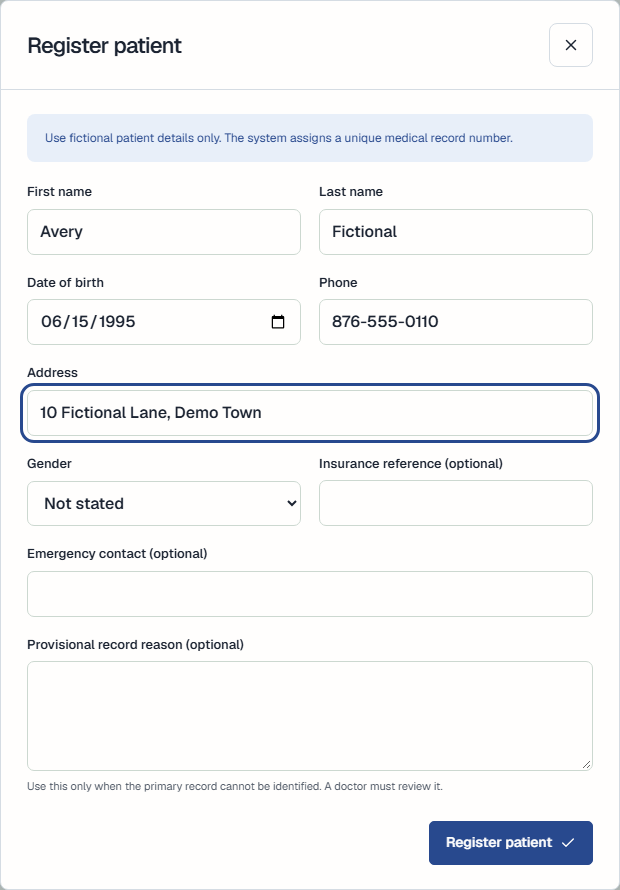
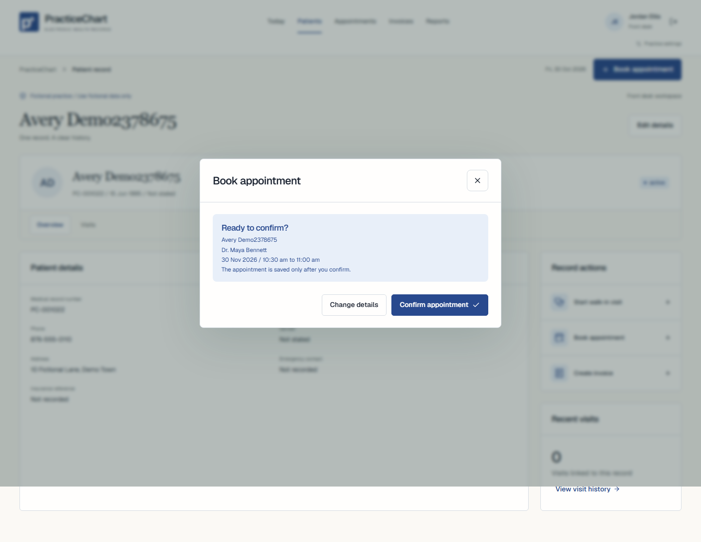
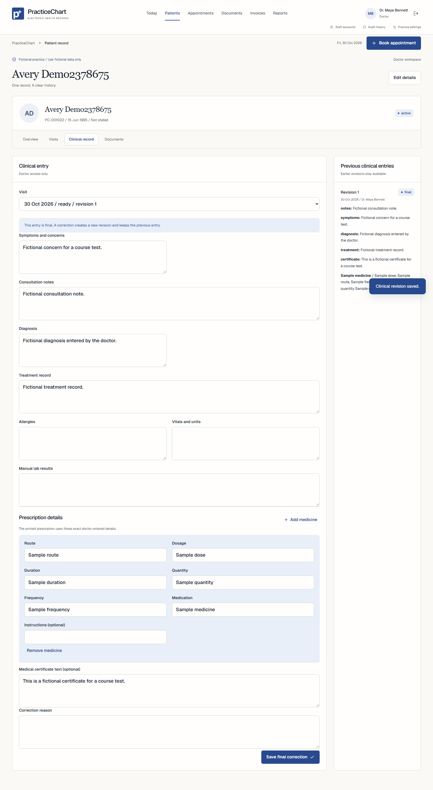
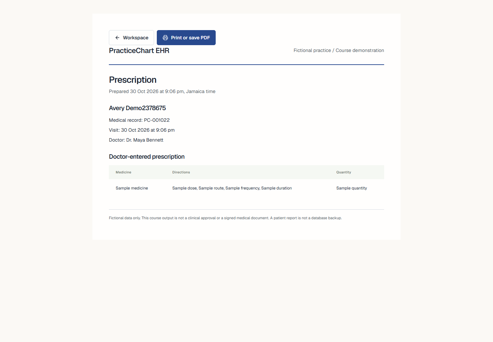
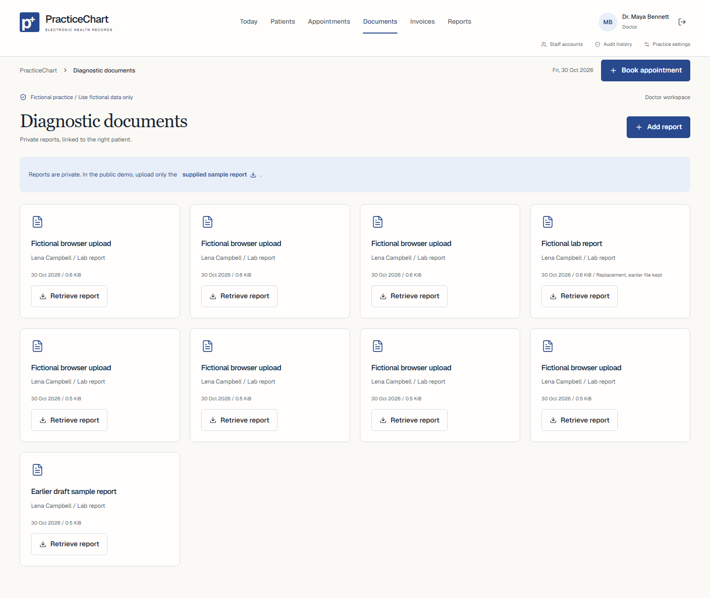
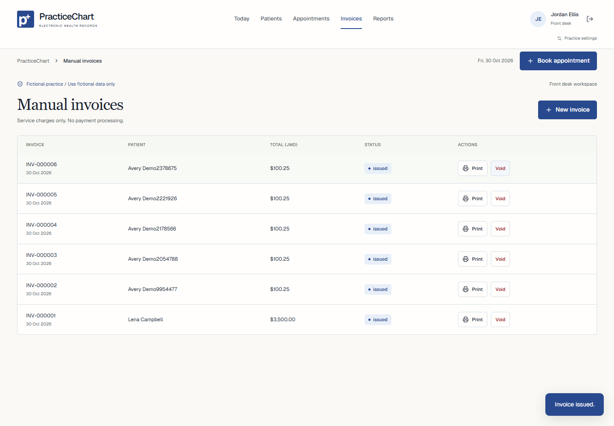

# PracticeChart user manual

PracticeChart stores fictional patient records for a course demonstration. The front desk manages administration. Doctors manage clinical information. Your account role determines what the server will let you read and change.

## Log in and log out

Open the website. Enter your username and password, then select Log in. The demo account buttons fill the public test credentials. They do not skip authentication. Select the exit icon beside your name to log out. On a phone, use More, Practice settings, then Log out.

The Today page shows the patient worklist, practice counts, ready visits, and reminders. Use the top navigation to open Patients, Appointments, Documents, Invoices, or Reports. Documents are available only to doctors. Management links appear only where your role allows them.

## Register and find a patient

Open Patients. Select Register patient. Enter the first and last names, date of birth, phone, and address. Optional fields include gender, emergency contact, and insurance reference. Use fictional details. Select Register patient to save.

The system assigns the MRN. It does not derive the MRN from a name. If a possible duplicate exists, the save message warns you. Check the existing record before continuing. People with the same name are not automatically treated as one person.

Search by name or MRN. Open the correct record. Select Edit details to change demographics. The server checks the record version. If another person changed it first, reload and review the current values before saving again.

An interim record needs a provisional reason. A doctor can link it to the primary record after review. Both MRNs and earlier histories remain available. Do not create another patient record merely because the service is unavailable.

## Book and manage an appointment

Select Book appointment. Choose the patient, doctor, date, length, and an available start time. Select Review appointment. Check the patient and interval. Select Confirm appointment to save it.

Times use Jamaica time. Availability can change while you review. The server and database check the interval again at confirmation. A conflict message means that the requested save did not complete. Choose another time.

Open Appointments and select a date. Use the appointment action menu to mark arrival, reschedule, cancel, or start the visit. Rescheduling requires a free interval. A failed reschedule keeps the original booking. Cancellation keeps the history and releases the slot.

## Start and complete a visit

For an appointment, use Start visit from its action menu. For a walk-in, open the patient and select Start walk-in visit. Choose the doctor. A walk-in record does not reserve an appointment slot.

A doctor opens the Clinical record section. Enter the findings, notes, diagnosis, treatment, and any manual lab results. Vitals must include the values and units entered by the doctor. PracticeChart supplies no diagnosis or treatment advice.

Save a draft while work is incomplete. To complete the entry, choose Final, ready for filing. A final entry requires a diagnosis. The front desk can then see that the visit is ready. It cannot see the clinical note or diagnosis.

To correct a final entry, enter the correction and a reason. Save final correction. The earlier revision remains in the history. Do not try to remove an earlier entry.

The front desk opens Visits and selects File visit after the doctor completes the entry. Filing records the visit in the logbook. It does not archive the patient.

## Prescriptions and certificates

The doctor can add medicine fields to the clinical entry. Enter medication, dosage, route, frequency, duration, quantity, and any instructions. The printed prescription uses those exact fields.

Enter certificate text only when a certificate is needed. Complete the clinical entry before printing. The course demo marks outputs as fictional. It does not create a real signed medical document.

## Diagnostic reports

Only a doctor can use the Documents page or the Documents section of a patient record. Download the supplied fictional sample report. Select Add report, choose the correct patient, enter its title and type, and select the file. Files must be PDF, PNG, or JPEG and no larger than 4 MiB.

Select Retrieve report to download the stored bytes. The server checks your session and role before it returns the file. A direct Blob address is not a public download link. When a report replaces another, supply the earlier document ID. The earlier file remains available.

## Invoices and reports

Create an invoice from the patient record or the Invoices page. Enter service descriptions, quantities, and unit charges in JMD. Review the draft and issue it. To void an issued invoice, enter a reason. The record remains in the history. An invoice is not proof of payment. PracticeChart does not process payments.

Use Reports for a daily appointment schedule, visit logbook, or doctor-only patient history. Use Visits for an attendance slip, clinical visit summary, prescription, or certificate. The front desk attendance slip omits diagnosis and treatment. Select Print or save PDF in the report window.

A patient report is a reading copy. It is not a database backup. Full database backup and recovery use operator commands described in RECOVERY.md.

## Phone and keyboard use

On a phone, use the bottom navigation and More menu. Forms use readable text and visible labels. The browser can zoom. Use Tab to move through controls. Use Enter or Space to activate a control. Use Escape to close a form. The patient section controls also support arrow keys, Home, and End.

Browser checks used a 390 by 844 pixel emulated phone view. A real phone test remains pending. Reduced-motion settings remove animation. Do not treat an automated accessibility scan as a complete accessibility review.

## Errors and support

If a save fails, read the message before retrying. A conflict needs a reload or a different appointment time. A missing file needs operator review. If the database or network is unavailable, the app does not create an offline clinical save. Keep the form information private and contact the group support lead.

The proposed conversion method is phased use with a parallel reference process. Start with fictional registration and scheduling tasks. Add clinical and report tasks after role training. This reduces change at one time and gives staff a comparison process. It also needs extra checking and clear control of the authoritative record. This is a proposed method, not evidence that a live conversion occurred.

The training plan and blank acceptance forms are in TRAINING_AND_ACCEPTANCE.md. No staff member is recorded as trained until attendance and task results are recorded.
