# PracticeChart user manual

Version: November 15, 2026. This manual follows the group's proposed-system role diagram. Use fictional patient data for the course demonstration.

## 1. Open the system and log in

Open https://practicechart-ehr.vercel.app. Enter your username and password. Select Log in. The demo buttons fill the public credentials; they do not bypass authentication.

| Role | Username | Demo password |
| --- | --- | --- |
| Receptionist | frontdesk | DeskDemo!2026 |
| Doctor | doctor | DoctorDemo!2026 |

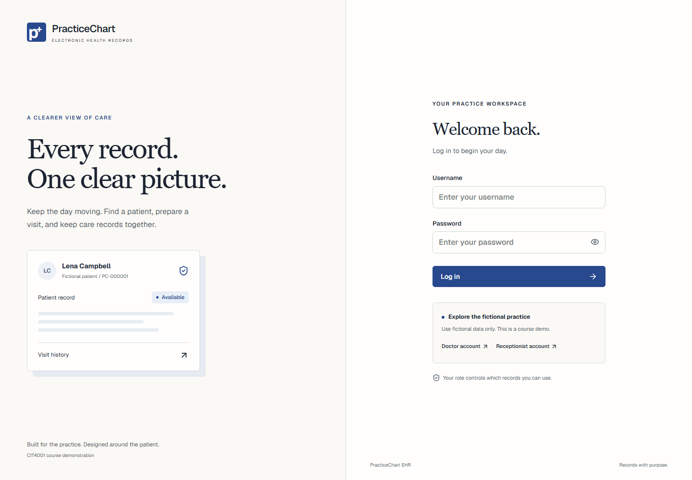

## 2. Understand the two workspaces

The receptionist registers patients, updates demographics, manages appointments, starts and files visits, creates manual invoices, uploads medical documents, and reviews visit counts. Receptionist is also called front desk in the stored role name. It cannot enter diagnoses, treatment, or lab results, or open private diagnostic file contents.

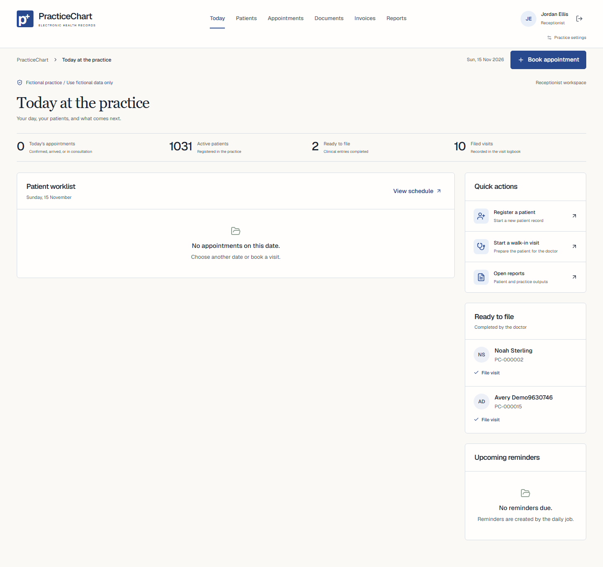

The doctor finds existing patients, opens prepared visits, records care and lab results, makes corrections, retrieves diagnostic reports, and prints clinical documents. The doctor can read the appointment worklist but cannot register patients, book appointments, file visits, create invoices, or manage staff accounts.

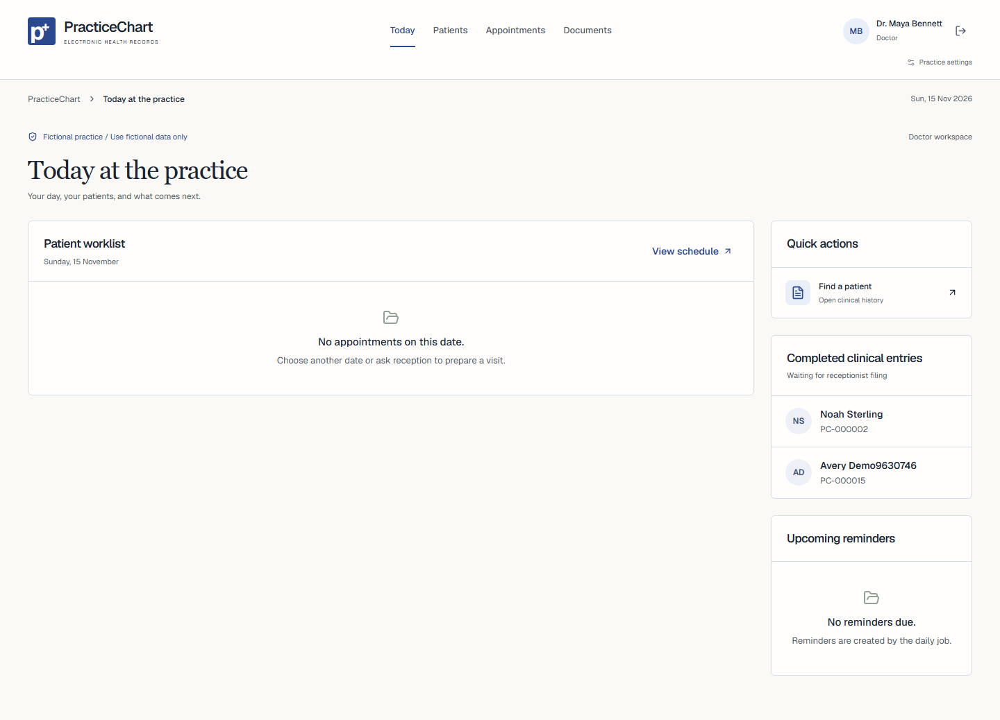

The receptionist supplies patient and visit information. The doctor records clinical information. They use one patient record with different permissions. Neither employee login provides staff account management or the global audit log. Technical operators handle those tasks outside the staff website.

## 3. Register a patient (receptionist)

Open Patients and select Register patient. Enter first name, last name, date of birth, phone, and address. Optional fields include gender, emergency contact, and insurance reference. Select Register patient to save. The server assigns a unique medical record number (MRN).

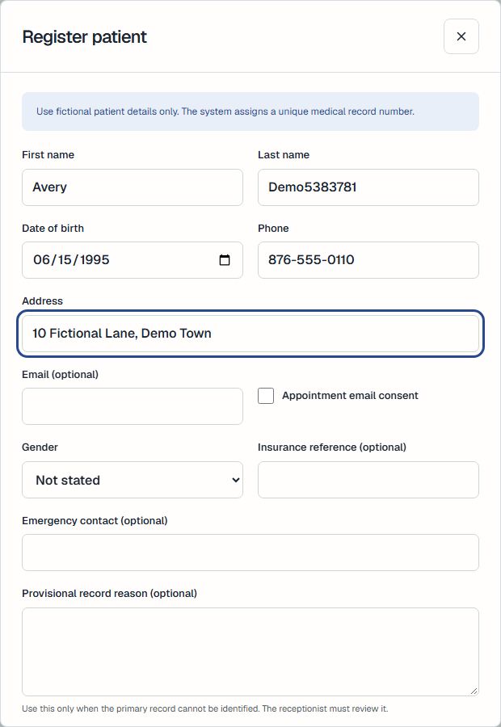

A possible duplicate warning does not block people who share names. Check the existing records. Create an interim record only with a clear provisional reason. The receptionist can later link it to the primary record. Both MRNs and earlier entries are kept. Do not create a second record because the database is unavailable.

## 4. Find and update a patient

Open Patients. Search by name or MRN and select the correct person. Both roles can find records. Only the receptionist can select Edit details and save demographic changes. If another person changed the record first, reload and review it before saving.

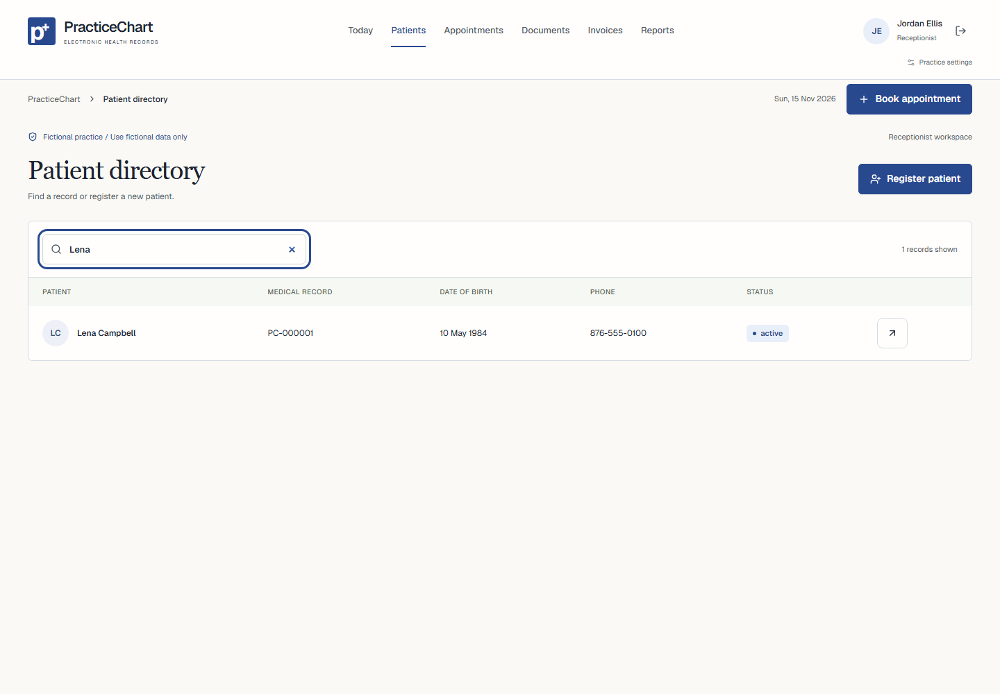

Archiving blocks new bookings. It does not delete the history. Filing a visit does not archive the patient.

## 5. Book an appointment (receptionist)

Select Book appointment. Choose the patient, doctor, weekday, visit length, and available start time. Search the patient selector by name or MRN if needed. Select Review appointment. Check the patient's name and MRN, doctor, date, and time. Select Confirm appointment to save.

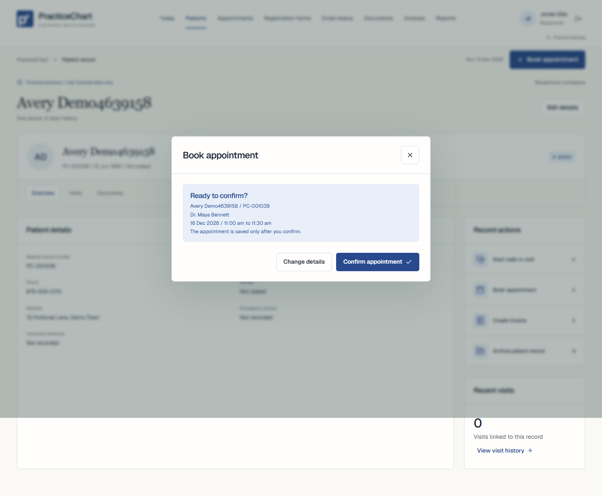

Times use Jamaica time. Availability checks the full visit length and both doctor and patient conflicts. The server checks again at confirmation. Choose another interval if it reports a conflict. The default practice hours are Monday to Friday, 08:00 to 17:00.

## 6. Manage appointments (receptionist)

Open Appointments and choose the Schedule date. Open Manage appointment for the correct patient. Mark arrival, reschedule, cancel, or start the visit as needed. Rescheduling keeps the visit length unless you change it. A failed reschedule keeps the original booking. Cancellation keeps the record and releases the interval.

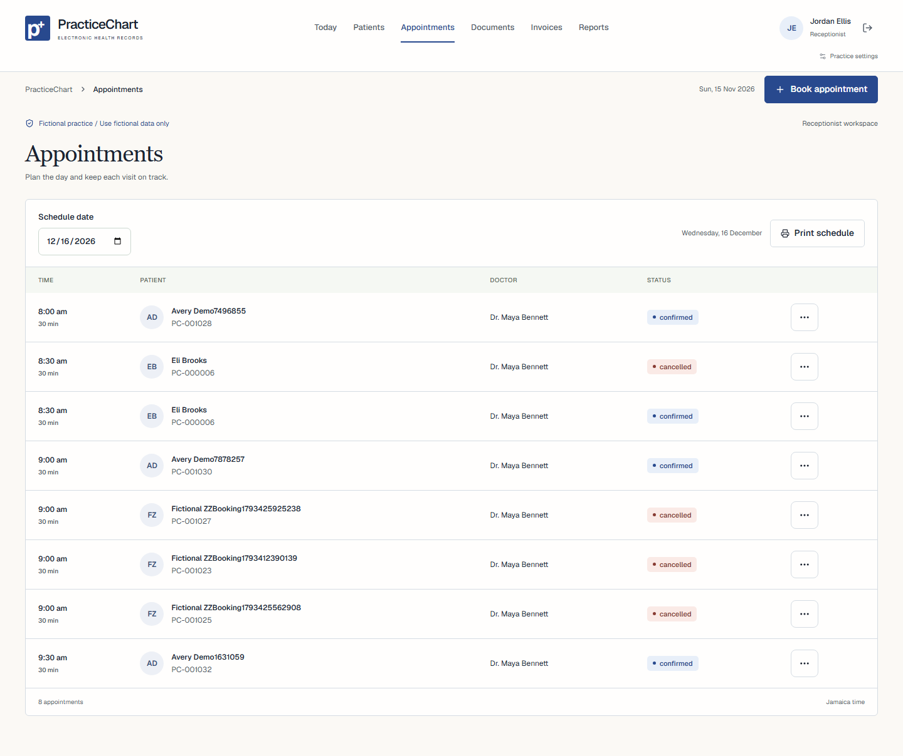

Select Print schedule for the chosen date. Under Practice settings, the receptionist can change working hours and add unavailable intervals. Conflicting bookings must be moved first. The doctor sees schedule information without these editing controls.

## 7. Prepare and file a visit (receptionist)

Start visit from an arrived appointment, or select Start walk-in visit in the patient record. Choose the doctor. A walk-in visit does not reserve an appointment interval. The doctor can now open that visit from the patient record.

After the doctor saves a final clinical entry, the receptionist sees the ready status. Select File visit. The server requires a final diagnosis before it files the visit and updates the digital logbook. Receptionists see readiness without seeing the diagnosis. An attendance slip excludes diagnosis and treatment.

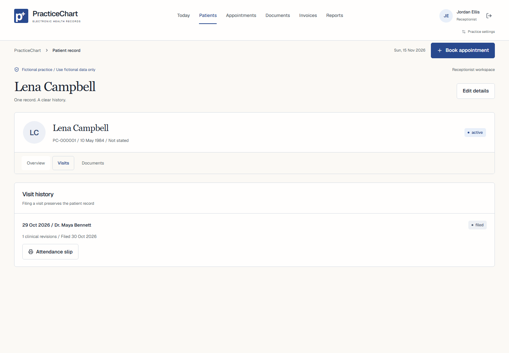

## 8. Record care and lab results (doctor)

Find the patient and open Visits. Select Open clinical record for the prepared visit. Enter symptoms, findings, diagnosis, treatment, vital values with units, and manual lab results. PracticeChart supplies no diagnosis or treatment advice.

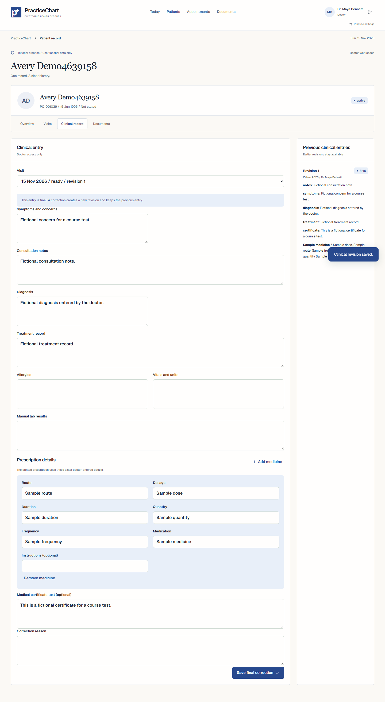

Save a draft while work is incomplete. Select Final, ready for filing when the entry is complete. A final entry requires a diagnosis. The receptionist can then file the visit.

To correct a final entry, change the necessary text, add a correction reason, and select Save final correction. Earlier entries keep their author, time, and content. Corrections to a filed visit do not remove its filing history.

## 9. Print prescriptions and medical certificates (doctor)

Enter each medication, dosage, route, frequency, duration, quantity, and any instructions in the clinical entry. Enter certificate text only when needed. Save the final entry. Under Visits, select Prescription, Certificate, Visit summary, or the patient history report. Use Print or save PDF in the report window.

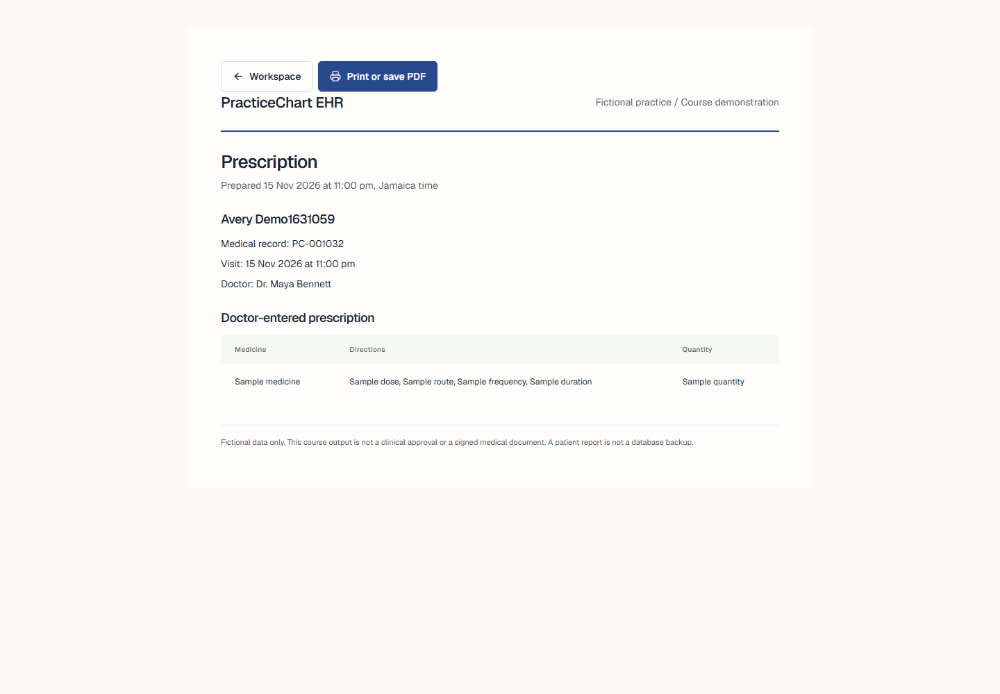

Outputs use only the doctor's entries. The course demo marks them as fictional. It does not supply a real signed medical document.

## 10. Upload medical documents (receptionist)

Open Documents or the patient's Documents section. Download the supplied fictional sample if using the public demo. Select Add report, choose the patient, enter the title and type, and select a PDF, PNG, or JPEG file up to 4 MiB. Select Store private report. The public demo accepts only the supplied sample.

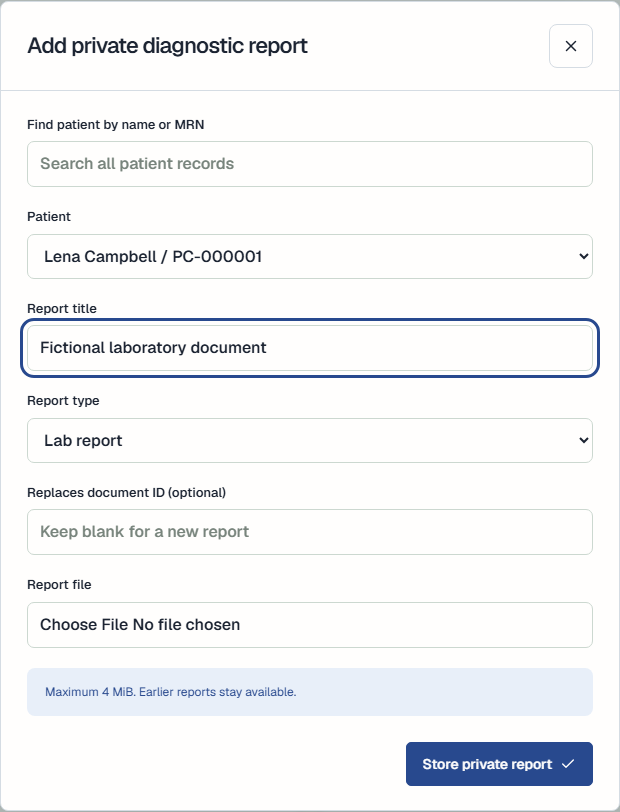

The document list shows titles and upload metadata. To add a replacement, use Add replacement in the patient's Documents section. The earlier file is kept. Uploading a document does not create or change the doctor's lab-result text. Receptionists cannot download diagnostic contents.

## 11. Retrieve diagnostic reports (doctor)

Open Documents or the patient's Documents section. Check the patient and title. Select Retrieve report. The server checks the doctor's session before returning the private file. Report contents are not available through an unsigned storage URL.

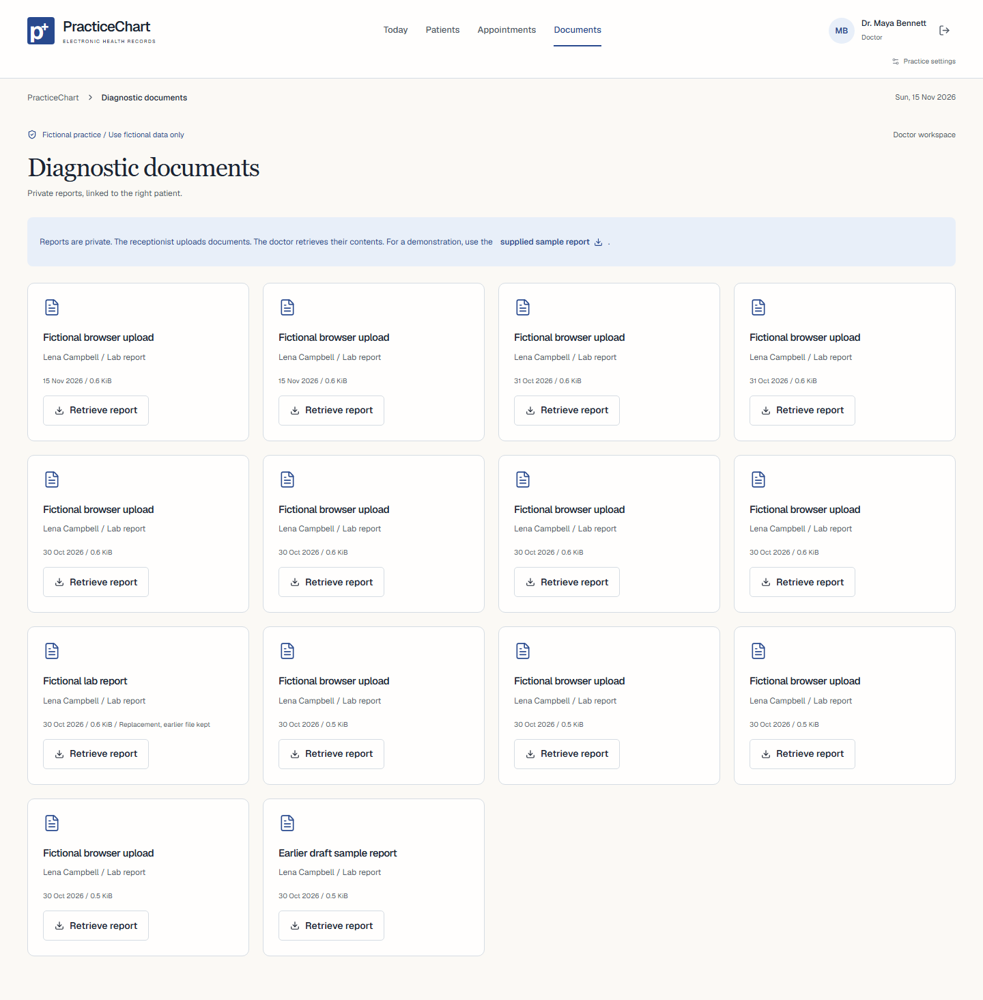

If a file is missing, contact the operator. Do not treat an unavailable file as a normal lab result.

## 12. Create manual invoices (receptionist)

Select Create invoice in a patient record or New invoice on the Invoices page. Enter service descriptions, quantities, and unit charges in JMD. Create the draft, review it, and issue it. To void an issued invoice, enter a reason. The record remains in the history.

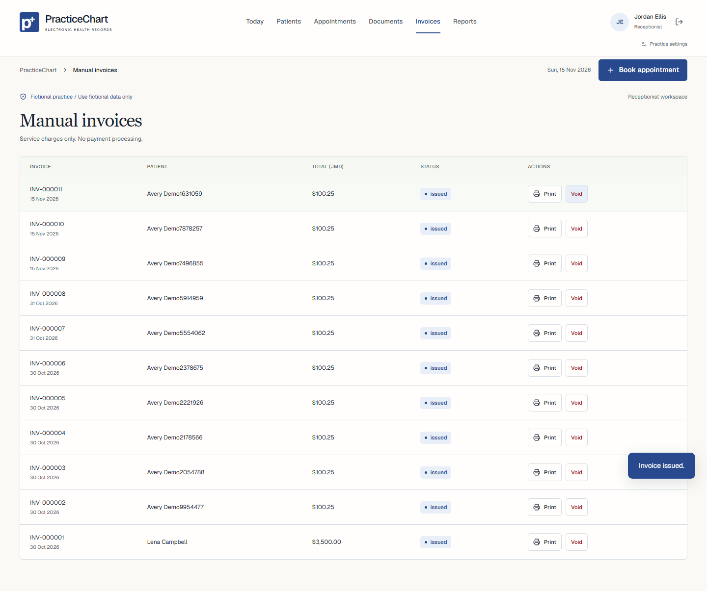

An invoice is not proof of payment. PracticeChart does not process payments. The clinical visit summary is a separate output.

## 13. Review visit counts (receptionist)

Open Reports. View visit counts and the logbook, or open a daily appointment schedule. These administrative outputs do not include clinical notes. The doctor prints clinical reports from the patient record.

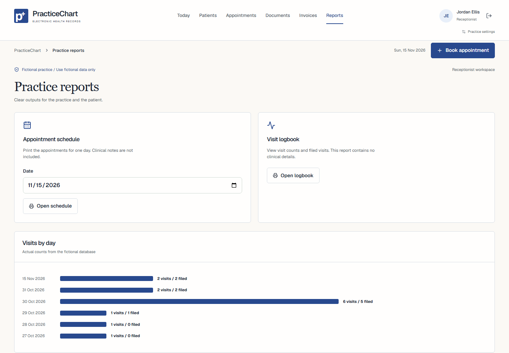

A patient report is a reading copy for one patient. It cannot restore the database. A full backup includes the separate EHR database and its referenced files. Only technical operators run backup and restore commands. See RECOVERY.md.

## 14. Use a phone, keyboard, and log out

On a phone, use the bottom navigation and More. Use Tab to move between controls, Enter or Space to activate a control, and Escape to close a form. Patient section tabs also support arrow keys, Home, and End. The browser can zoom. Reduced-motion settings remove motion.

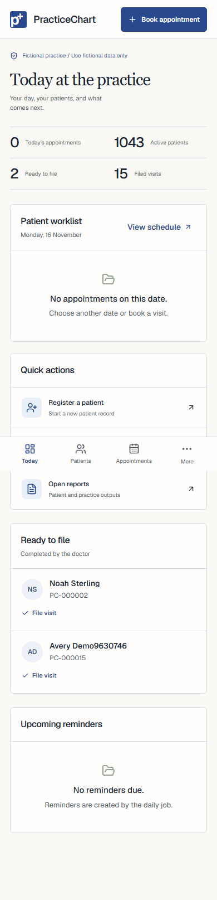

On a desktop, select the exit icon beside your name. On a phone, select More, Practice settings, then Log out. This ends the session. The supplied public demo accounts cannot change their passwords. Local accounts can change their own password under Practice settings.

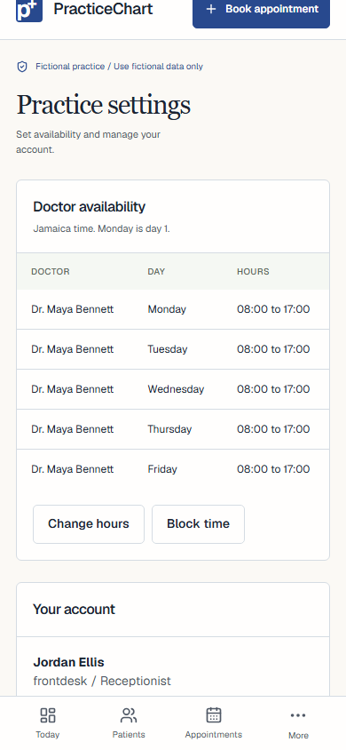

## 15. Errors and support

Read a failed-save message before retrying. A conflict needs a reload or a different interval. The system does not confirm a save when the database is unavailable. Keep any unsaved information private. Contact the group's named support lead with the action, time, and error message. Do not send patient details or passwords to a group chat.

## 16. Implementation method

The proposed method is phased introduction with a parallel reference process. Prepare the database, private storage, accounts, backup, and printed manual first. Test with fictional data. Start with receptionist registration and scheduling. Then introduce doctor clinical recording, documents, and receptionist filing. Check the authoritative record at each handoff. Agree on a fallback process and a clear cutover decision before any real use.

This is a proposed implementation method for the case study. The course demo is not evidence of a live practice rollout. Keep the current local database and upload folder before an upgrade. Test a restore in an isolated copy. Do not overwrite live data during a test.

For a local demonstration, install Node.js 24 or later and Docker Desktop. In the application folder run npm ci, npm run setup, then npm run dev. Open http://localhost:3000. The database volume and private upload folder preserve data between restarts. GROUP_START_GUIDE.md contains the full setup and demonstration script.

## 17. Training and acceptance

Training is planned, not completed. Demonstrate each task, let the trainee practise with fictional data, and then ask them to repeat it without help. Record errors and repeat failed tasks.

| Session | Audience | Planned task check |
| --- | --- | --- |
| Login, privacy, and logout, 20 minutes | Both roles | Explain role limits and end a session |
| Registration and records, 30 minutes | Receptionist | Register, search, edit, and check an interim record |
| Scheduling and filing, 30 minutes | Receptionist | Confirm, reschedule, cancel, start, and file a ready visit |
| Clinical recording, 40 minutes | Doctor | Save a draft, final entry, lab result, and correction |
| Documents and outputs, 25 minutes | Both, using their assigned tasks | Receptionist uploads; doctor retrieves and prints clinical outputs |
| Invoices and visit counts, 20 minutes | Receptionist | Issue and void a sample invoice; read visit counts |
| Recovery, 30 minutes | Technical operator | Restore into an isolated database and private file folder |

Use the attendance records, task checklists, and blank acceptance forms in TRAINING_AND_ACCEPTANCE.md. Record actual participant, date, role, result, and issues after the session. Do not mark staff trained or accepted before they complete the tasks. Keep follow-up support and an issue register.

Browser checks use emulated phone layouts. A real phone check, human usability testing, and signed acceptance remain group tasks.

## 18. Complete registration as a patient

Open /register, or select Patient registration form on the login page. Enter the name, birth date, phone, and address. Enter an email only if needed. Select email consent only if appointment mail is wanted. Agree to reception review, then select Send registration form. Keep the reference shown after submission.

On the public demo, select Use fictional example first. The server accepts only that example. The local presentation copy permits other fictional test records. A submitted form has no MRN and does not confirm an appointment. Patients cannot search or read records.

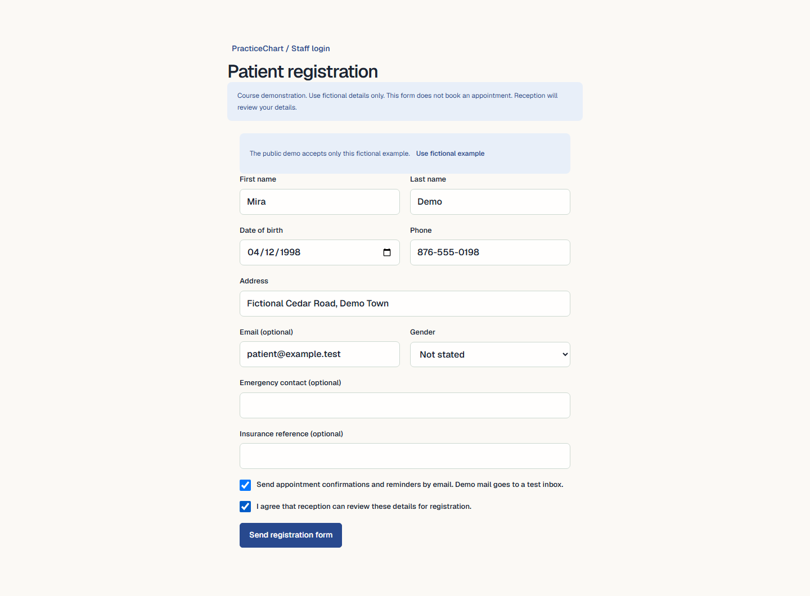

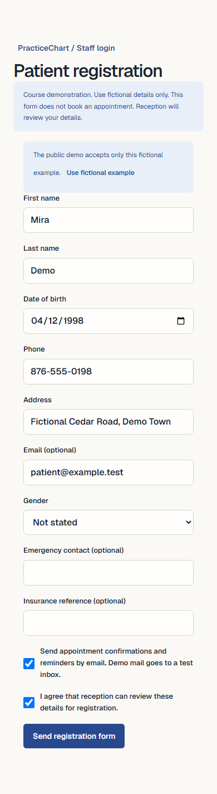

## 19. Review patient registration forms (receptionist)

Open Registration forms. Check the submitted details. Select Accept and register. If a matching name and birth date exist, open the existing file before creating a new one. Enter a reason only when this is a separate patient. For an incorrect or repeated form, enter a rejection reason and select Reject form. The accepted record receives a unique MRN. Two staff members cannot accept the same form twice.

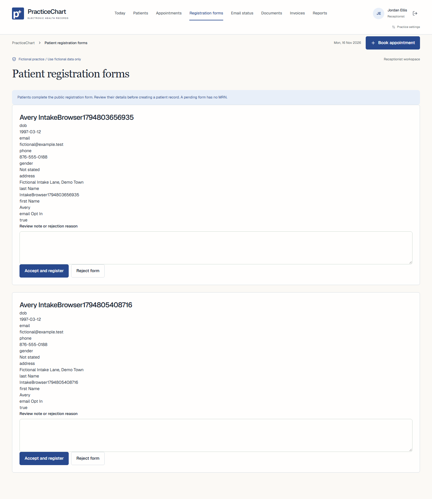

The receptionist can still use Register patient to enter a form directly. A possible duplicate is checked before that save too. For an interim record, give a provisional reason. A doctor must review the interim record before reception links it to the primary file. Both MRNs and their original entries remain available.

## 20. Check appointment email (receptionist)

Enter the patient's email and appointment email consent in demographics. Booking or rescheduling queues a confirmation. The notification system also queues reminders for confirmed appointments within 24 hours. Open Email status to check the result. Select Refresh status after a worker runs. Select Retry due email to start processing due retries.

Sent means the provider accepted the request. Queued, failed, and skipped have different meanings. No clinical details are sent. Public demo mail always goes to a provider test inbox. Do not expect a message at the address entered into the demo.

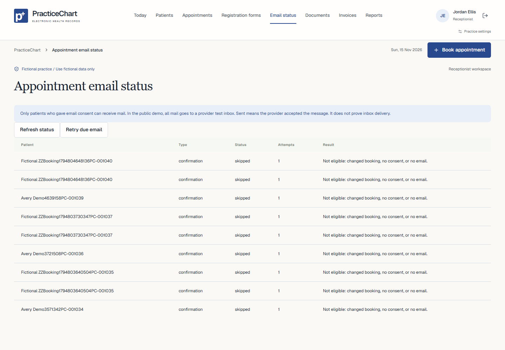

For a lab report upload, choose Report type set to Lab report and select the matching visit. The server rejects a visit belonging to another patient. Other diagnostic documents can be stored at patient level. Earlier files remain available when a replacement is added.
